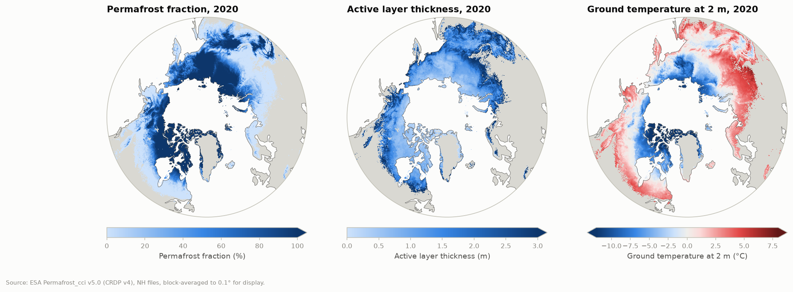
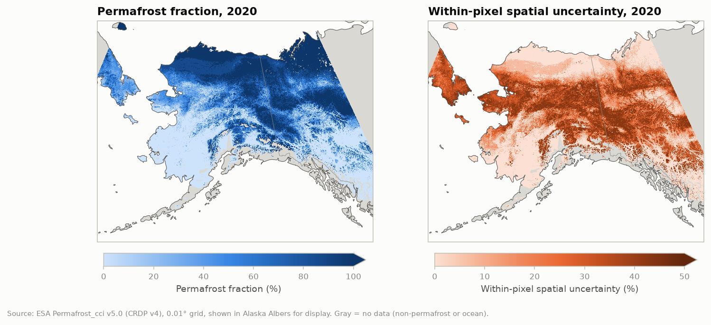
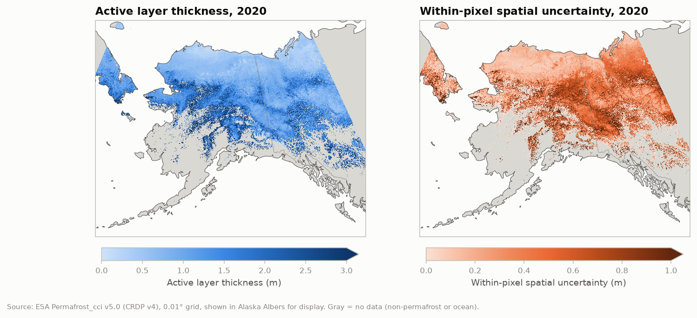
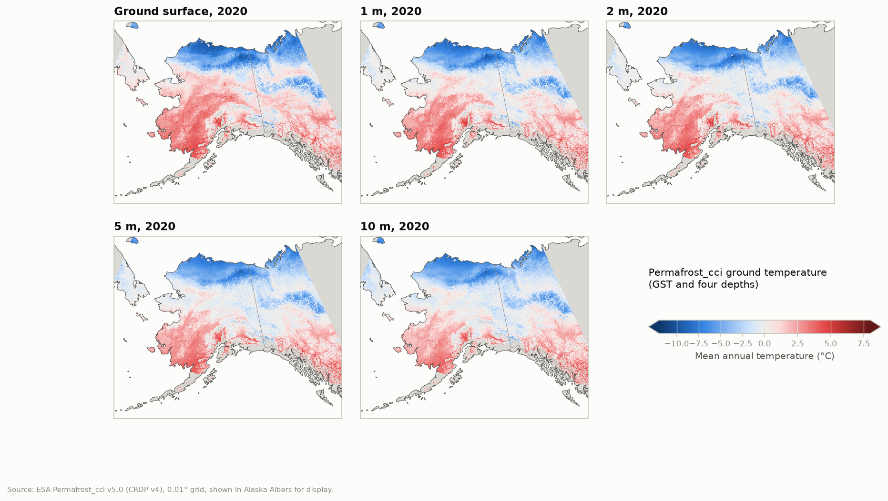
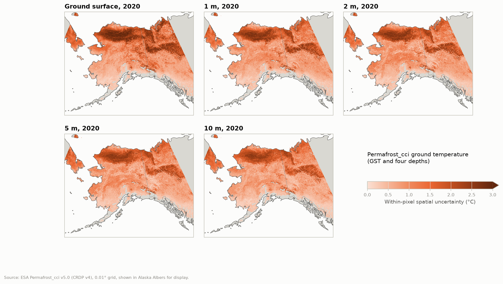
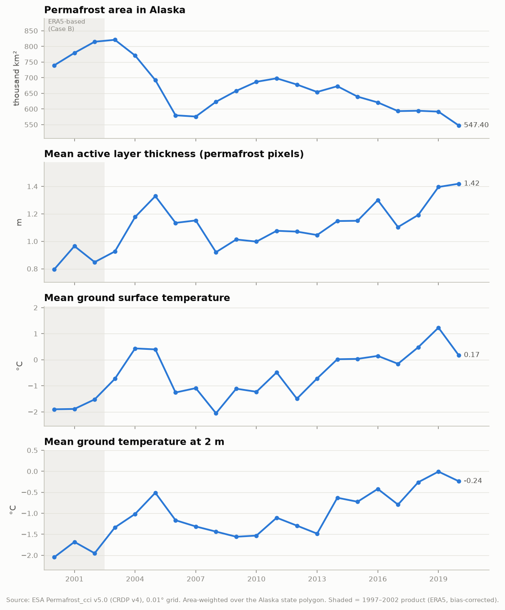
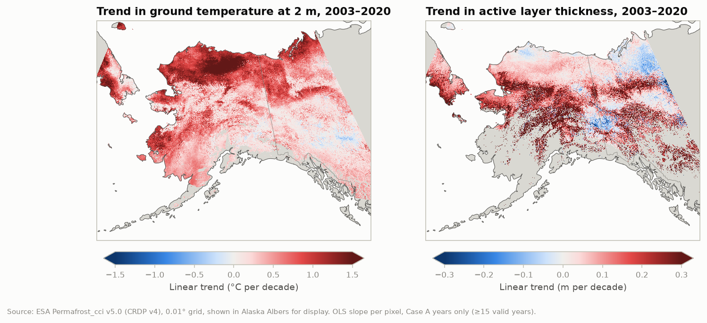
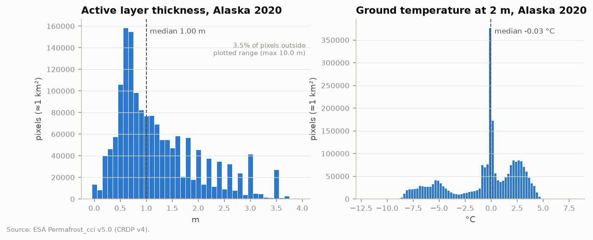

# ESA CCI CRDP v4: Permafrost, Snow and Land Cover — Exploratory Data Analysis

Exploratory look at three components of the ESA Climate Change Initiative (CCI) Climate Research Data
Package v4 (CRDP v4). The target domain is the Northern Hemisphere (NH) pan-Arctic; the exploratory focus is
**Alaska, 2000–2020**. Abbreviations are defined in the [table at the end](#abbreviations).

| Component | Status in this repo | Current CRDP v4 product(s) |
|---|---|---|
| **Permafrost** | **Downloaded** (Northern Hemisphere files, all years) and subset to Alaska 2000–2020; plots below | Permafrost_cci file version 5.0 |
| **Snow** | **Catalogued only** (archive listing + file headers, no data downloaded) | Snow_cci v4.0 |
| **Land cover** | **Catalogued only** (archive listing + file headers, no data downloaded) | Land_Cover_cci maps v2.0.7, PFT v2.0.81 |

Per-product tables (file counts, sizes, dimensions, variables, attributes) are generated by
[`inventory.py`](inventory.py) into [`inventory.md`](inventory.md) and [`metadata/*.json`](metadata/).
This document summarizes and interprets them.

---

## Key findings

**Permafrost**
- All three permafrost products sit on the same **0.01° WGS84 (EPSG:4326) grid**, 25–85°N, in **one file per year from 1997 to 2023**. Together they are 81 files and 10.2 GB.
- **Two forcing regimes:** 1997–2002 is "Case B" (downscaled, bias-corrected ERA5) and 2003–2023 is "Case A" (MODIS LST + ERA5). The method changes at 2002/2003, so trend work should start in 2003.
- **Ground temperature has five depths** (GST, 1, 2, 5, 10 m), each with an uncertainty layer. The CEDA catalogue page lists only T2m, but the files contain all five.
- **Alaska 2003→2020** (area-weighted over the state polygon): permafrost area fell from 821 to 547 thousand km². Mean ALT on permafrost pixels rose from 0.93 to 1.42 m, and mean T2m rose from −1.34 to −0.24 °C. Year-to-year variability is large (see the time series).
- **Data quirks:** ALT is stored on discrete model-layer steps (0.1 m near the surface, coarser deeper) with a maximum of 15 m. T2m shows a large spike at 0 °C (the zero-curtain effect).

**Snow and land cover (catalogue only)**
- **The full Snow_cci v4.0 archive is about 3 TB.** About 2.7 TB of that is the global daily 1 km MODIS and 5 km AVHRR snow cover fraction. SWE is only 13.6 GB, but **SWE (not snow cover fraction) is masked over mountainous terrain**, which covers much of Alaska's mountains. [Why](#why-swe-is-masked-over-mountains).
- **CEDA's Land Cover CCI maps stop at 2015.** The 2016–2022 continuation (v2.1.1) is on the Copernicus CDS. The PFT product runs 1992–2020.
- **The three components are linked.** Permafrost_cci uses Land Cover CCI to set CryoGrid's thermal properties, and Snow_cci uses Land Cover CCI (year 2000) for its water and permanent-ice masks.
- **NASA ABoVE land cover is independent of CCI land cover.** ABoVE is Landsat-based at 30 m, CCI is 300 m from MERIS/PROBA-V/Sentinel-3, and neither cites the other. Details are in [the comparison section](#relation-to-nasa-above-land-cover).

---

## Sources and documentation

All data are open access from the [CEDA archive](https://data.ceda.ac.uk/neodc/esacci) (no login). The ESA
[CCI Open Data Portal](https://climate.esa.int/en/data/) indexes the same holdings.

### Permafrost_cci (v5.0 files = CRDP v4)

| Product | CEDA catalogue / DOI |
|---|---|
| Active layer thickness, NH | [catalogue](https://catalogue.ceda.ac.uk/uuid/a6fbedd8ee5b472c8e84e55f746c1704/) · doi:10.5285/a6fbedd8ee5b472c8e84e55f746c1704 |
| Ground temperature, NH | [catalogue](https://catalogue.ceda.ac.uk/uuid/5675b0be944f45a8af0e7ddbeb47a011/) · doi:10.5285/5675b0be944f45a8af0e7ddbeb47a011 |
| Permafrost extent (fraction), NH | [catalogue](https://catalogue.ceda.ac.uk/uuid/d235665772ec4b558e9a89ac85595e71/) · doi:10.5285/d235665772ec4b558e9a89ac85595e71 |

Documentation:
- [Product User Guide v5.0](https://climate.esa.int/documents/3107/CCI_PERMA_PUG_v5.0.pdf) (15 Sep 2025, describes CRDPv4 / file version 5)
- [CRDP v5.0 description](https://climate.esa.int/documents/3106/CCI_PERMA_D3.2_CRDP_5.0.pdf)
- Older PUGs (v4.0, v4.1) in the [CEDA docs folder](https://dap.ceda.ac.uk/neodc/esacci/permafrost/docs/)
- [Project page](https://climate.esa.int/en/projects/permafrost/)
- Algorithm reference: Westermann et al. 2016, [doi:10.5194/gmd-9-523-2016](https://doi.org/10.5194/gmd-9-523-2016) (CryoGrid 2)

### Snow_cci v4.0 (CRDP v4)

| Product | DOI (from file metadata) |
|---|---|
| SWE, merged passive microwave | [10.5285/edf8abd23f4a40aabd4d52e48dec06ea](https://catalogue.ceda.ac.uk/uuid/edf8abd23f4a40aabd4d52e48dec06ea/) |
| Snow cover fraction on ground (SCFG), MODIS | [10.5285/375ffdb8f0a445e380b4b9548655f5f9](https://catalogue.ceda.ac.uk/uuid/375ffdb8f0a445e380b4b9548655f5f9/) |
| Snow cover fraction viewable (SCFV), MODIS | [10.5285/bc13bb02a958449aac139853c4638f32](https://catalogue.ceda.ac.uk/uuid/bc13bb02a958449aac139853c4638f32/) |
| SCFG, AVHRR single-sensor | [10.5285/80d96e3a14854420b6f742d70877c431](https://catalogue.ceda.ac.uk/uuid/80d96e3a14854420b6f742d70877c431/) |
| SCFV, AVHRR single-sensor | [10.5285/3c71c04cf08a410fac2c680cbf88cfd7](https://catalogue.ceda.ac.uk/uuid/3c71c04cf08a410fac2c680cbf88cfd7/) |

Documentation:
- [Product User Guide v5.1](https://climate.esa.int/media/documents/Snow_cci_D4.3_PUG_v5.1.pdf) (19 Dec 2025, covers the CRDP v4.0 products)
- [CRDP v4.1 description](https://climate.esa.int/media/documents/Snow_cci_D4.2_CRDP_v4.1.pdf)
- The [CEDA docs folder](https://dap.ceda.ac.uk/neodc/esacci/snow/docs/) holds PUG v4.0 (April 2024), which describes the *v3* products
- [Snow_cci data page](https://climate.esa.int/en/projects/snow/Snow_data/) · [ENVEO Snow_cci site](https://snow-cci.enveo.at/)

### Land_Cover_cci

| Product | Catalogue / DOI |
|---|---|
| Land cover maps v2.0.7 (1992–2015) | [CEDA catalogue](https://catalogue.ceda.ac.uk/uuid/b382ebe6679d44b8b0e68ea4ef4b701c/) |
| Land cover maps v2.1.1 (2016–2022, C3S) | [Copernicus CDS: satellite-land-cover](https://cds.climate.copernicus.eu/datasets/satellite-land-cover) (needs a CDS account) |
| Plant functional types v2.0.81 (1992–2020) | doi:[10.5285/313854aedcb04a5eb56f711401a87396](https://catalogue.ceda.ac.uk/uuid/313854aedcb04a5eb56f711401a87396/) |
| Water bodies v4.0 (static, 2000–2012) | CEDA archive `land_cover/data/water_bodies/v4.0` |

Documentation:
- [Product User Guide v2.5](https://dap.ceda.ac.uk/neodc/esacci/land_cover/docs/ESACCI-LC-PUG-v2.5.pdf)
- [Quick User Guide, LC maps v2.0.7](https://dap.ceda.ac.uk/neodc/esacci/land_cover/docs/ESACCI-LC-QuickUserGuide-LC-Maps_v2-0-7.pdf)
- PFT method: Harper et al. 2023, [ESSD 15, 1465–1499](https://essd.copernicus.org/articles/15/1465/2023/)
- [UCLouvain CCI-LC viewer and download/release notes](https://maps.elie.ucl.ac.be/CCI/viewer/download.php)

---

## Data access and reproduction

```bash
micromamba create -f environment.yml && micromamba activate esa-cci
python pipeline/crawl.py --all                 # file manifests -> <data_root>/manifests/*.csv
python pipeline/download.py --theme permafrost # ~10 GB; skips completed files, resumable
python -I pipeline/subset.py --theme permafrost   # Alaska 2000–2020, native grid
python -I eda/inventory.py                     # inventory.md + metadata/*.json
python -I eda/plot_permafrost.py               # eda/plots/*.png
```

Paths, products and the Alaska bbox are set in [`pipeline/config.yaml`](../pipeline/config.yaml). Snow and
land cover products have `download: false`, and `download.py` refuses them unless you pass `--force`.

Remote metadata reads use netCDF HTTP byte-range access (`xr.open_dataset(url + "#mode=bytes")`), which
fetches only the header and the chunks you request. CEDA's plain OPeNDAP (DAP2) endpoint returned 404 for these paths.

---

## Directory structure

### CEDA archive layout (relevant parts)

```
/neodc/esacci/
├── permafrost/data/
│   ├── active_layer_thickness/L4/area4/pp/v05.0/{northern_hemisphere,Antarctica}/{YYYY}/
│   │     ESACCI-PERMAFROST-L4-ALT-<FORCING>-AREA4_PP-{YYYY}-fv05.0.nc
│   ├── ground_temperature/L4/area4/pp/v05.0/...      (…-L4-GTD-…)
│   └── permafrost_extent/L4/area4/pp/v05.0/...       (…-L4-PFR-…)
│        <FORCING> = ERA5_MODISLST_BIASCORRECTED (1997–2002) | MODISLST_CRYOGRID (2003–2023)
│        (v01.0–v04.0 also archived; 131.7 GB across all versions)
├── snow/data/
│   ├── swe/MERGED/v4.0/{YYYY}/{MM}/YYYYMMDD-ESACCI-L3C_SNOW-SWE-{SMMR_NIMBUS7|SSMI_DMSP|SSMIS_DMSP}-fv4.0.nc
│   ├── scfg/MODIS/v4.0/{YYYY}/{MM}/YYYYMMDD-ESACCI-L3C_SNOW-SCFG-MODIS_TERRA-fv4.0.nc
│   ├── scfg/AVHRR_SINGLE/v4.0/AVHRR_<SAT>/{YYYY}/{MM}/YYYYMMDD-ESACCI-L3C_SNOW-SCFG-AVHRR_<SAT>-fv4.0.nc
│   └── scfv/… (same layout as scfg)
│        (also archived: older versions, AVHRR_MERGED, ATSR-2, AATSR, CryoClim, SLSTR; 6.6 TB total)
└── land_cover/data/
    ├── land_cover_maps/v2.0.7/ESACCI-LC-L4-LCCS-Map-300m-P1Y-{YYYY}-v2.0.7b.nc   (+ GeoTIFFs, legend CSV/QML)
    ├── pft/v2.0.81/ESACCI-LC-L4-PFT-Map-300m-P1Y-{YYYY}-v2.0.81.nc
    └── water_bodies/v4.0/ESACCI-LC-L4-WB-Map-150m-P13Y-2000-v4.0.nc
```

### Local layout

```
/import/beegfs/CMIP6/jdpaul3/esa-cci/         # data_root (config.yaml)
├── raw/permafrost/data/…/v05.0/northern_hemisphere/{YYYY}/*.nc   # exact mirror of the CEDA paths
├── alaska/{permafrost_alt,permafrost_gt,permafrost_pfr}/*.nc     # Alaska bbox, native grid, 2000–2020
└── manifests/*.csv                                               # crawl.py file lists (path, bytes, mtime)

ESA-CCI/                                       # this repo
├── environment.yml
├── pipeline/   ceda.py crawl.py config.yaml config.py download.py subset.py
└── eda/        EDA.md inventory.md inventory.py plot_permafrost.py plotstyle.py metadata/ plots/
```

---

## Holdings: file counts and sizes

Sizes use binary units, matching the CEDA catalogue (1 GB = 1024³ bytes).

| Product | Version | Years | Archive files | Archive size | Local raw | Alaska subset |
|---|---|---|---:|---:|---|---|
| Permafrost ALT, NH | v5.0 | 1997–2023 | 27 | 804 MB | 27 files, 804 MB | 21 files, 74 MB |
| Permafrost ground temperature, NH | v5.0 | 1997–2023 | 27 | 9.1 GB | 27 files, 9.1 GB | 21 files, 765 MB |
| Permafrost extent (PFR), NH | v5.0 | 1997–2023 | 27 | 318 MB | 27 files, 318 MB | 21 files, 31 MB |
| Snow SWE | v4.0 | 1979–2023 | 9,575 | 13.6 GB | catalog only | – |
| Snow SCFG, MODIS | v4.0 | 2000–2023 | 8,642 | 819 GB | catalog only | – |
| Snow SCFV, MODIS | v4.0 | 2000–2023 | 8,642 | 816 GB | catalog only | – |
| Snow SCFG, AVHRR (all satellites) | v4.0 | 1979–2023 | 37,062 | 530 GB | catalog only | – |
| Snow SCFV, AVHRR (all satellites) | v4.0 | 1979–2023 | 37,062 | 533 GB | catalog only | – |
| Land cover maps (.nc only) | v2.0.7 | 1992–2015 | 24 | 57 GB | catalog only | – |
| Land cover PFT | v2.0.81 | 1992–2020 | 29 | 48 GB | catalog only | – |
| Land cover water bodies | v4.0 | static | 1 | 127 MB | catalog only | – |

---

## Permafrost_cci v5.0 (downloaded)

### Spatial and temporal domain, grid, CRS

| | |
|---|---|
| Spatial domain | Northern hemisphere 25.005–84.995°N, 179.995°W–179.995°E (Arctic and high-mountain permafrost, nominally north of 30°N) |
| Grid | Regular lat/lon, 0.01° (≈1 km), 6,000 × 36,000 cells; coordinates are cell centres |
| CRS | WGS 84 geographic, **EPSG:4326** (WKT in the `spatial_ref` grid-mapping variable) |
| Temporal | Annual means (ALT = annual maximum thaw depth), 1997–2023, one file per year, time stamp = 1 Jan |
| Forcing | 1997–2002 **Case B**: downscaled ERA5 air temperature bias-corrected against Case A. 2003–2023 **Case A**: MODIS LST (MOD11A1/MYD11A1 C6) merged with downscaled ERA5 |
| Model | CryoGrid 2 transient ground thermal model; thermal properties set from land cover (file metadata: "ESA CCI Land Cover dataset v1.6.1") |
| Format | NetCDF-4, CF conventions, chunked 1×1000×1000, deflate level 9; packed integers |
| Institution | University of Oslo |

### Variables

| File | Variable | Description | Units | Storage |
|---|---|---|---|---|
| ALT | `ALT` | Active layer thickness (maximum seasonal thaw depth) | m | uint16 × 0.01, fill 65535 |
| ALT | `ALT_uncertainty` | Within-pixel spatial variability of ALT | m | uint16 × 0.01 |
| GTD | `GST` | Mean annual ground surface temperature (0 m) | °C | uint16 × 0.01 − 273.15, fill 65535 |
| GTD | `T1m`, `T2m`, `T5m`, `T10m` | Mean annual ground temperature at 1, 2, 5 and 10 m depth | °C | uint16 × 0.01 − 273.15 |
| GTD | `*_uncertainty` (×5) | Within-pixel spatial variability of each temperature | °C | uint16 × 0.01 − 273.15 (decodes to ≥ 0) |
| PFR | `PFR` | Permafrost area fraction of the pixel | % | uint8, fill 255 |
| PFR | `PFR_uncertainty` | Uncertainty of permafrost fraction | % | uint8, fill 255 |

All files also include `lat`, `lon`, `time` (hours since 1950-01-01) and the scalar `spatial_ref`.

### Quirks found during EDA

- **Latitude order differs between files and their metadata.** The raw files store `lat` *ascending* (25→85°N). Their `GeoTransform` attribute (`-180 0.01 0 90 0 -0.01`) describes a north-up grid starting at 90°N, which matches neither the coordinate order nor the extent. Use the coordinate variables, not `GeoTransform`. `subset.py` handles either order.
- **ALT is quantized.** Values fall on CryoGrid layer depths: 0.1 m steps near the surface, 0.2 m steps below about 1.5 m. Histograms need step-aligned bins. The maximum is 15 m and the NH 99.9th percentile is 7 m, so very deep "active layers" mark near-permafrost-free cells. In Alaska in 2020, 3.5% of ALT pixels exceed 4 m.
- **T2m has a large spike at 0 °C** (the zero-curtain/latent-heat effect). That makes the Alaska median T2m (−0.03 °C in 2020) a poor summary.
- **The CEDA catalogue page lists only T2m**, but the ground temperature files contain GST, T1m, T2m, T5m and T10m.
- **The method step at 2002/2003 is visible.** In the Alaska series, mean GST jumps by about 0.8 °C from 2002 to 2003. I computed the trend maps over 2003–2020 only.
- **Antarctic files exist** (`v05.0/Antarctica`, 2003–2023 Case A + 1997–2002 Case B) but were not downloaded.

### Alaska 2000–2020 subset

The subsets are cut to bbox 50–72.5°N, 180–125°W on the native grid (2,250 × 5,500 cells). The box also takes in Yukon,
northern BC and a sliver of Chukotka; the western Aleutians across the antimeridian are excluded. Statewide statistics
use a rasterized Natural Earth Alaska polygon with cos(latitude) area weights.

| Year | Permafrost area (10³ km²) | Mean ALT, permafrost pixels (m) | Mean GST (°C) | Mean T2m (°C) |
|---|---:|---:|---:|---:|
| 2000 (Case B) | 739 | 0.80 | −1.90 | −2.05 |
| 2003 | 821 | 0.93 | −0.73 | −1.34 |
| 2010 | 687 | 1.00 | −1.23 | −1.53 |
| 2015 | 639 | 1.15 | 0.03 | −0.73 |
| 2020 | 547 | 1.42 | 0.17 | −0.24 |

### Plots

All maps are drawn in Alaska Albers (EPSG:3338) **for display only**; the data stay on the native 0.01° grid.
Gray land = no data (for example, non-permafrost cells for ALT).

| Figure | What it shows |
|---|---|
|  | **Pan-Arctic overview, 2020:** permafrost fraction, ALT and T2m, block-averaged to 0.1° |
|  | **Alaska permafrost fraction and its uncertainty, 2020** |
|  | **Alaska ALT and its uncertainty, 2020** |
|  | **Ground temperature at all five depths, 2020** (diverging scale centred on 0 °C) |
|  | **Within-pixel uncertainty of each ground temperature layer, 2020** |
|  | **Statewide annual series, 2000–2020**, Case B years shaded |
|  | **Per-pixel linear trends, 2003–2020:** T2m (°C/decade) and ALT (m/decade) |
|  | **Distributions of ALT and T2m across Alaska, 2020** |

What the plots suggest (exploratory, not validated):
- Ground temperatures are coldest on the North Slope and the Brooks Range. The 0 °C line runs roughly through the
  interior and continuous permafrost gives way to discontinuous going south. Southwest Alaska and the Alaska
  Peninsula have mean annual ground temperatures well above 0 °C.
- T2m warming over 2003–2020 is strongest on the North Slope (often more than 1 °C/decade) and in western Alaska. ALT
  deepens mostly across the discontinuous zone, with patches of thinning in the eastern interior and Yukon.
- Uncertainty (within-pixel variability) is highest for ground temperature on the North Slope and in the Yukon.
  For PFR, it is highest in the discontinuous zone, where the fraction is neither 0 nor 100%.

---

## Snow_cci v4.0 (catalogue only)

| | SWE | SCFG / SCFV MODIS | SCFG / SCFV AVHRR |
|---|---|---|---|
| Measures | Snow mass (water equivalent) | Snow cover fraction per pixel: on ground (canopy-corrected) / viewable from above | Same as MODIS |
| Sensors | SMMR (Nimbus-7), SSM/I and SSMIS (DMSP) | Terra MODIS C6.1 L1B | AVHRR on TIROS-N, NOAA-6…19, MetOp-A/B/C (EUMETSAT AVHRR FDR) |
| Method | GlobSnow-style Bayesian assimilation of passive microwave with synoptic snow-depth observations; dynamic snow density | Multispectral retrieval with forest-canopy transmissivity correction for SCFG; ENVEO cloud screening | Same family, University of Bern; CLARA-A3 cloud mask (CM SAF) |
| Grid | 0.1° global lat/lon (1,800 × 3,600); retrievals NH land only | 0.01° global (18,000 × 36,000) | 0.05° global (3,600 × 7,200) |
| CRS | EPSG:4326 | EPSG:4326 | EPSG:4326 |
| Time | Daily 1988–2023, bi-daily 1979–1987; **snow season only** (Oct–May, few files in Jun/Sep) | Daily, 24 Feb 2000 – 2023 | Daily, 1979–2023, **one file per satellite per day** (overlapping sensors) |
| Variables | `swe` (mm), `swe_std` | `scfg`/`scfv` (%), `*_unc` (unbiased RMSE, %), `satzen`, `scanline_time` | Same as MODIS |
| Flags | swe: −30 glacier, −20 mountain, −10 water, −1 no data, 0 no snow | 205 cloud, 206 polar night/night, 210 water, 213 salt lake, 215 permanent snow/ice, 252–254 retrieval failures, 255 fill | 205, 206, 210, 215, 254 |
| Institution | FMI | ENVEO | University of Bern |

How snow connects to the other components:
- The water and permanent snow/ice masks come from **Land Cover CCI year 2000**, and the forest mask is static (2000).
- The snow products share the 0.01° grid with Permafrost_cci and LST_cci, so the MODIS SCF products overlay the permafrost grid cell for cell.

Limitations relevant to Alaska (from the PUG):
- SWE applies a **complex-terrain mask** (flag −20), which should cover the Brooks Range, Alaska Range and coastal mountains; see [below](#why-swe-is-masked-over-mountains). Land ice (−30) and water (−10) are masked too. The snow cover fraction products have **no** terrain mask; only clouds, night, water and permanent ice are flagged.
- SCF products are **cloud-limited**, with no retrieval in polar night (206). Daily Alaska coverage in winter is sparse, so most uses need temporal compositing.
- AVHRR files overlap in time (up to three satellites on the same day). Users must choose or merge sensors; see the [errata](https://dap.ceda.ac.uk/neodc/esacci/snow/data/scfg/AVHRR_SINGLE/v4.0/errata.txt) for files added late in 2025.
- **Usefulness relative to ERA5 snow is an open question.** The CCI products are observation-based (SWE assimilates stations; SCF is satellite-only), where ERA5 snow is model-based. Their distinctive value is the 1 km observed snow cover fraction.

### Why SWE is masked over mountains

Only the **SWE** product is terrain-masked. The MODIS and AVHRR snow cover fraction products retrieve snow in mountains.
The mask is inherited from the GlobSnow SWE algorithm that Snow_cci SWE is built on. The Snow_cci user guide (PUG v5.1,
§5) says only that a "complex-terrain mask is applied based on the sub-grid variability in elevation… because of known
limitations in alpine terrain". The criterion is documented for GlobSnow v3.0 (Luojus et al. 2021):

- **Mask rule:** a grid cell is masked when the **standard deviation of elevation within the 25 km EASE-grid cell exceeds
  200 m**, computed from the ETOPO5 DEM. In the files, those cells are set to `swe = −20` ("Masked: mountain"). The Snow_cci
  v4 documents mention a "high-resolution DEM" but don't state the threshold, so treat 200 m as the inherited GlobSnow value.

Why the retrieval is not trusted there:
1. **Footprint versus terrain scale.** Passive microwave footprints are about 15–69 km, gridded at 12.5–25 km. In mountains,
   snow depth changes over hundreds of metres with elevation, aspect and wind redistribution, so one footprint mixes very
   different snowpacks. The grid spacing "is incompatible with the scales of SWE variability in complex terrain"
   (Sun et al. 2025).
2. **Signal saturation in deep snow.** The 19/37 GHz brightness-temperature difference stops increasing at about 150 mm SWE
   (GlobSnow), or roughly 1 m snow depth (PUG v5.1), so deep mountain snowpacks are underestimated.
3. **Wet snow.** A little liquid water makes the snowpack absorb rather than scatter microwaves, and the SWE signal is lost.
   Melt events, rain-on-snow and maritime snowpacks are common in Alaska's coastal ranges.
4. **The station background field breaks down.** The algorithm assimilates a background snow-depth field kriged from
   synoptic weather stations, which assumes that field represents spatial snow patterns. Stations are sparse and sit in
   valleys, so they can't capture mountain snow-depth variability. Luojus et al. state that this assumption "does not hold
   for complex terrain (mountains)".
5. **Terrain effects on emission** (a general passive-microwave limitation, not stated in the Snow_cci/GlobSnow documents).
   Slopes change the local viewing geometry and add emission from surrounding terrain, which a flat-surface emission
   model doesn't represent.

**Consequences:** SWE is designed for terrestrial seasonal snow on low-relief terrain (tundra, boreal plains). GlobSnow
hemispheric snow-mass totals explicitly **exclude mountain snow**. For Alaska's mountains, use the CCI snow cover fraction
(extent only) or a model/reanalysis product such as ERA5, or a mountain SWE reanalysis. Check how much of your study
area carries the −20 flag before using SWE there.

Mountain-mask references:
[Luojus et al. 2021, GlobSnow v3.0 NH SWE dataset, *Sci Data* 8:163](https://pmc.ncbi.nlm.nih.gov/articles/PMC8249486) ·
[Sun et al. 2025, *The Cryosphere* 19, 2017–2036](https://tc.copernicus.org/articles/19/2017/2025/) ·
[Snow_cci PUG v5.1](https://climate.esa.int/media/documents/Snow_cci_D4.3_PUG_v5.1.pdf) §5.

Other snow datasets in the archive, not part of CRDP v4: earlier versions (SWE v1–v3.1, MODIS SCF v1–v3), AVHRR_MERGED v1/v2,
ATSR-2 and AATSR (1995–2012), CryoClim (1982–2019), and SLSTR v1.0 (2020–2022).

---

## Land_Cover_cci (catalogue only)

| | Land cover maps v2.0.7 | Plant functional types v2.0.81 | Water bodies v4.0 |
|---|---|---|---|
| Content | Annual UN-LCCS class map (22 global + regional classes) | Annual % cover of 14 PFTs + land/water layers | Static land/water mask |
| Years on CEDA | 1992–2015 (2016–2022 as v2.1.1 on the C3S CDS) | 1992–2020 | 2000–2012 composite |
| Grid | 1/360° ≈ 300 m global (64,800 × 129,600) | 1/360° ≈ 300 m global | 1/720° ≈ 150 m global (129,600 × 259,200) |
| CRS | WGS 84 geographic (WKT in `crs`, no EPSG code; equivalent to EPSG:4326) | No grid-mapping variable; WGS 84 lat/lon per docs | WGS 84 geographic (as for the maps) |
| Variables | `lccs_class`, `processed_flag`, `current_pixel_state`, `observation_count`, `change_count` | `TREES-{BD,BE,ND,NE}`, `SHRUBS-{BD,BE,ND,NE}`, `GRASS-{NAT,MAN}`, `BARE`, `BUILT`, `SNOWICE`, `WATER`, `WATER_INLAND`, `WATER_OCEAN`, `LAND` | `wb_class` (1 land, 2 water) |
| File size | ≈ 2.4 GB/yr (.nc) | ≈ 1.6 GB/yr | 127 MB |
| License | ESA CCI data policy (free and open) | CC BY 4.0 | ESA CCI data policy |

What the land cover products are derived from:
- **LC maps:** a 2003–2012 MERIS (FR + RR) baseline map is back-dated and updated with per-pixel change detection from
  AVHRR (1992–1999), SPOT-VGT (1999–2013), PROBA-V (2013+) and Sentinel-3 OLCI/SLSTR (later C3S years). These boundaries are
  approximate, since the sources give slightly different years. The legend follows FAO UN-LCCS. Reported overall accuracy is about 71% (2015 map).
- **PFT:** the LC maps are fused with Landsat-era products: Hansen tree cover (30 m), JRC surface water (30 m), Potapov
  GEDI tree height (only to 52°N, so not over most of Alaska), GHSL built-up, Köppen–Geiger zones and landforms
  (Harper et al. 2023). This replaces the old static class-to-PFT cross-walk table.
- **Water bodies:** Envisat ASAR, 2000–2012.

Notes:
- **`lccs_class` is stored as signed int8 with `_Unsigned="true"`.** Read it with CF decoding on (`mask_and_scale=True`) or
  cast to uint8; otherwise classes ≥ 130 appear as negative numbers.
- The **high-resolution land cover** CCI project covers Africa, Amazonia and Siberia only (980 GB). **There is no Alaska coverage.**
- A newer **PFT v2.0.82** (Dec 2025; C3/C4 grass split) is announced on the UCLouvain viewer but is **not on CEDA**.
- CEDA also holds LC maps v1.6.1 (5-year epochs 2000/2005/2010) and PFT v2.0.8.

### Relation to NASA ABoVE land cover

| | Land_Cover_cci (maps / PFT) | ABoVE annual land cover, Wang et al. 2019 | ABoVE boreal land cover, Hu et al. 2025 |
|---|---|---|---|
| Dataset | ESA CCI / C3S | [ORNL DAAC 1691](https://daac.ornl.gov/cgi-bin/dsviewer.pl?ds_id=1691) | [ORNL DAAC 2423](https://daac.ornl.gov/cgi-bin/dsviewer.pl?ds_id=2423) |
| Coverage | Global | ABoVE core domain (Alaska + western Canada, including tundra) | Boreal Alaska + Canada (tundra excluded) |
| Years | 1992–2015 (CEDA), 2016–2022 (CDS); PFT 1992–2020 | 1984–2014 | 1986–2020 |
| Resolution / grid | 300 m, WGS84 lat/lon | 30 m, ABoVE Albers B-grid tiles (180 km) | 30 m, NAD83 Canada Albers (ESRI:102001), ABoVE B-grid tiles |
| Input sensors | MERIS, AVHRR, SPOT-VGT, PROBA-V, Sentinel-3 | Landsat 5/7 surface reflectance | Landsat Collection 2 (CCDC change detection) |
| Legend | 22 UN-LCCS classes / 14 PFT fractions | 15-class and 10-class dominant PFT (incl. tussock tundra, low/tall shrub) | 9 classes (evergreen/deciduous/mixed forest, shrub, herb, bare, water, wetland, ice/snow) |
| Training / validation | GlobCover-heritage validation database | Field photography + high-resolution imagery, Random Forests | Canadian NFI photo plots, Random Forests; 79% overall accuracy |

**Relationship:** I found no data lineage between the two families. ABoVE's user guides never mention CCI, and the CCI LC and
PFT documentation never mentions ABoVE. They are independent products built from different sensors at a 10× difference in
resolution, with different legends. The overlaps are conceptual and indirect:
1. Both describe vegetation in plant-functional-type terms, so CCI PFT fractions can be compared with ABoVE dominant-PFT classes aggregated to 300 m.
2. Both depend on the Landsat archive somewhere: ABoVE directly, CCI PFT through Hansen tree cover and JRC water.
3. ABoVE is far better suited to tundra shrub and tussock detail in Alaska. CCI's advantage is a consistent global series and its role as an input to Permafrost_cci and Snow_cci.

---

## Open questions and possible next steps

- Decide whether any snow product earns a download, given the existing ERA5 snow holdings. The most distinctive candidate is
  MODIS SCFG at 1 km (about 820 GB global; much less if cropped to the pan-Arctic on download).
- Decide whether to fetch the 2016–2022 LC maps from the CDS (needs a CDS API key) or the PFT series, for example to compare with ABoVE over Alaska.
- Permafrost: validate against GTN-P boreholes and CALM ALT sites in Alaska. Quantify the Case B/Case A step using the
  2003–2005 overlap behaviour. Compare with the existing ABoVE/GIPL permafrost products.

---

## Abbreviations

| Term | Meaning |
|---|---|
| ABoVE | NASA Arctic-Boreal Vulnerability Experiment |
| ALT | Active layer thickness: maximum annual seasonal thaw depth above permafrost (m) |
| AVHRR | Advanced Very High Resolution Radiometer (NOAA / MetOp satellites) |
| C3S / CDS | Copernicus Climate Change Service / its Climate Data Store |
| CCI | ESA Climate Change Initiative |
| CEDA | Centre for Environmental Data Analysis (UK), host of the CCI archive |
| CRDP | Climate Research Data Package: a versioned CCI data release (CRDP v4 = Permafrost file v5.0, Snow v4.0) |
| CRS / EPSG | Coordinate reference system / EPSG registry code (EPSG:4326 = WGS 84 lat/lon; EPSG:3338 = Alaska Albers) |
| CryoGrid | Ground thermal model used by Permafrost_cci |
| DEM | Digital elevation model |
| EASE-grid | Equal-Area Scalable Earth grid (used by passive microwave SWE retrievals) |
| ERA5 | ECMWF fifth-generation global reanalysis |
| GST | Ground surface temperature (mean annual, °C) |
| GTD | Ground temperature at depth (Permafrost_cci file type holding GST, T1m, T2m, T5m, T10m) |
| LC | Land cover |
| LST | Land surface temperature (from MODIS MOD11A1/MYD11A1) |
| MODIS | Moderate Resolution Imaging Spectroradiometer (Terra/Aqua) |
| NH | Northern Hemisphere |
| PFR | Permafrost fraction: percent of a pixel underlain by permafrost |
| PFT | Plant functional type |
| PUG | Product User Guide |
| SCF / SCFG / SCFV | Snow cover fraction / on ground (canopy-corrected) / viewable from above the canopy |
| SWE | Snow water equivalent: depth of water if the snowpack melted (mm) |
| T1m…T10m | Mean annual ground temperature at 1, 2, 5, 10 m depth (°C) |
| UN-LCCS | UN FAO Land Cover Classification System (the CCI land cover legend) |
| Case A / Case B | Permafrost_cci forcing regimes: A = MODIS LST + ERA5 (2003–2023), B = bias-corrected ERA5 only (1997–2002) |
